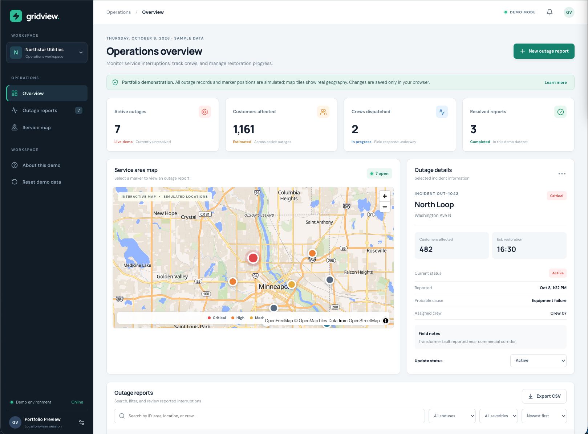
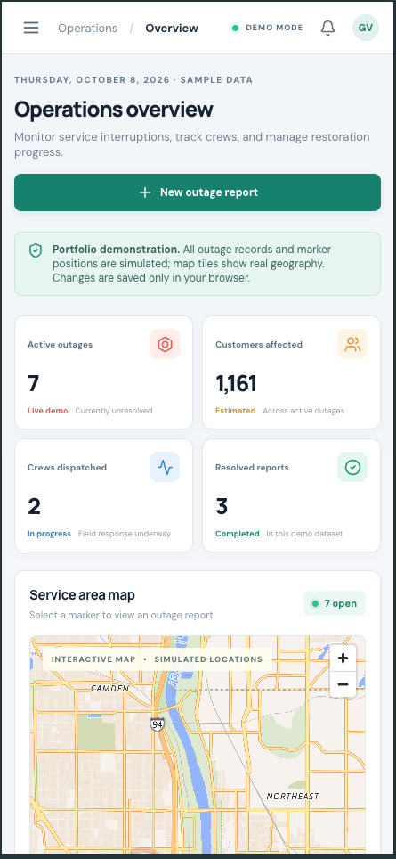

# GridView — Utility Operations Dashboard

A responsive frontend portfolio project for exploring fictional electric-utility outage operations. GridView brings outage reports, service-area mapping, filtering, and status updates into one interface.

> **Portfolio demo only.** GridView is not connected to a utility company or live outage system. All incident reports, crews, customer counts, and outage marker positions are simulated. The basemap depicts real geography, but markers are **not** geocoded to the displayed addresses. No employer source code or confidential data is included.

<!-- Add a real screenshot after testing: screenshots/dashboard-desktop.png -->


## Features

- Dashboard cards summarizing active outages, affected customers, dispatched crews, and resolved reports
- Interactive MapLibre GL JS map with severity-coded outage markers
- Linked map, incident table, and details panel: selecting an outage updates the other views
- Search, filter, and sort outage reports
- Create reports, update statuses, and export filtered reports as CSV
- Browser-local persistence via `localStorage`, with a reset-to-demo option
- Responsive layouts, keyboard-visible focus, accessible report selection, and dialog keyboard handling
- Unit and component tests using Vitest and React Testing Library

## Technology

**React, TypeScript, Vite, CSS, MapLibre GL JS, OpenFreeMap basemap tiles, Vitest, React Testing Library.** No PHP server, database, user authentication, or live utility API is included.

## Getting started

**Requirements:** Node.js 22 (recommended) and npm. The project requires internet access to load basemap tiles.

```bash
git clone https://github.com/YOUR_USERNAME/gridview-utility-dashboard.git
cd gridview-utility-dashboard
npm install
npm run dev
```

Open the local URL printed by Vite (typically `http://localhost:5173`). Replace `YOUR_USERNAME` after creating the repository. If using the downloaded ZIP instead of GitHub, open the extracted project folder and start at `npm install`.

### Build and tests

```bash
npm test          # run automated tests
npm run build     # TypeScript check + production bundle
npm run preview   # preview production bundle locally
```

**Verification status:** Run these commands locally before submission and record the actual results in your GitHub pull request or commit notes. This README does not claim a passing build or audit that has not been confirmed.

## How to try the demo

1. Select a marker on the map to open its incident details.
2. Select an outage ID in the table and watch the map recenter.
3. Search for `OUT-1042`, filter by status, or change the sort order.
4. Create a new fictional outage report, then update its status.
5. Refresh the page to confirm the report persists in this browser.
6. Export the filtered incidents to CSV, or reset to the original demo records.

## Project structure

```text
src/
  components/
    AccessibleDialog.tsx  # dialog focus and Escape handling
    NewOutageForm.tsx     # report creation and validation
    OutageMap.tsx        # MapLibre markers and selection
  data/outages.ts        # fictional demo incidents
  lib/
    mapCoordinates.ts   # simulated map positions
    outageUtils.ts      # filtering, sorting, metrics, CSV
    storage.ts          # localStorage helpers
  tests/                # unit and component tests
  App.tsx               # dashboard composition and state
  styles.css            # responsive styles and focus states
```

## Engineering decisions

- **Client-side state:** React holds the current incident list and selection. Pure utility functions compute filtered results and metrics, making behavior easier to test.
- **Local persistence:** `localStorage` keeps the demo self-contained. It is not a replacement for secure multi-user persistence or a production API.
- **Map integration:** MapLibre renders a geographic basemap; incident coordinates are generated from simulated positions, not real outage reports. The map depends on third-party tiles and may be unavailable offline.
- **Interaction design:** The map and table share selected-incident state. Outage selection is also available through explicit table buttons, so the map is not the only route to incident details.
- **Accessibility:** The project includes focus indicators, labeled form controls, dialog keyboard handling, and reduced-motion styling. These are implementation measures, **not a claim of WCAG certification**.

## Limitations

- Demo-only data; no real-time feeds, accounts, database, or PHP API
- Simulated outage coordinates; new report addresses are not geocoded
- Map tiles require an internet connection and are supplied by an external provider
- `localStorage` data is browser-specific and can be cleared by the user
- Additional manual keyboard, screen-reader, mobile, and cross-browser testing is recommended

## Screenshots

## Screenshots

### Desktop Dashboard


### Mobile Dashboard


## Third-party services

MapLibre GL JS provides the map renderer. Basemap tiles are requested from [OpenFreeMap](https://openfreemap.org/); see the provider's current usage terms and attribution requirements. Map attribution is displayed in the map controls.
